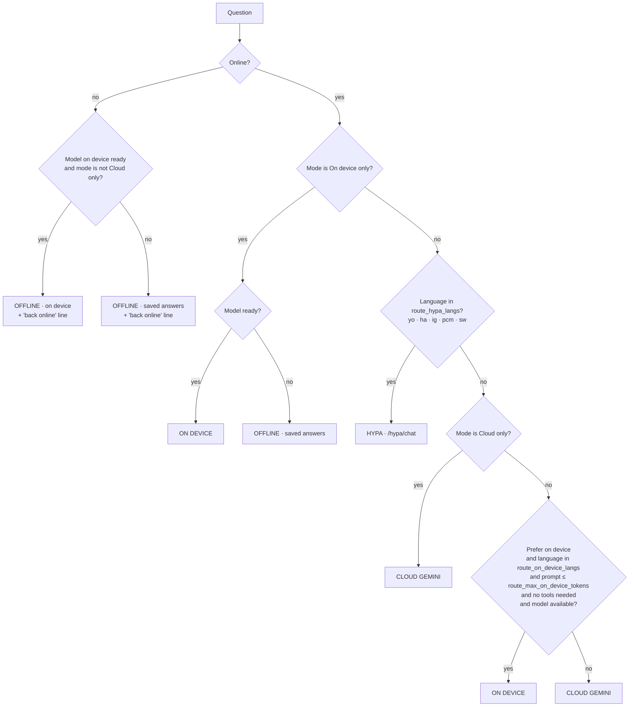

# Hybrid router (G05, HYP-200)

Where every AI task in Hypa Stories runs, how the choice is made, and which tasks do not go through the router (and why).

## 1. Overview

| Task | Through the router? | Entry point | Can run on |
|---|---|---|---|
| [Storyteller answer](#3-storyteller-answer) | **Yes** | `HybridStoryQa.AnswerAsync` | on device, Hypa, cloud Gemini, saved answers |
| [Word question tools](#word-questions-tools) ("what does ìyá mean?") | **Yes** (part of the answer) | `HybridStoryQa.Tools()` | cloud Gemini, which calls Hypa |
| [Try Hypa translation](#4-try-hypa-translation) | **Yes** | `HybridTryApi.TranslateAsync` | on device, Hypa |
| [Storyteller voice](#61-storyteller-voice-tts) (lines, answers, fillers) | No | `StoryVoice.PrepareAsync` | Hypa `/hypa/tts` |
| [Microphone](#62-microphone-speech-to-text) | No | `MicListener.Listen` | Hypa `/hypa/asr` |
| [Try Hypa extras](#63-try-hypa-extras) (languages, dictionary, explain, speak) | No | `HypaTryApi` | Hypa MCP (old path) |
| [Lens](#64-lens) | No | `HypaCoreLensApi` | Hypa MCP (old path), out of scope |
| [Route stats](#7-route-stats) | n/a (records the router's choices) | `IRouteLog.Log` | Firestore |

## 2. What the router looks at

`HybridRouter.Decide(RouteAsk, RouteContext)` (`Assets/HypaCore/Runtime/Firebase/HybridRouter.cs`) is pure: the same inputs always give the same route. It is asked once per question or translation.

| Input | Field | Where it comes from |
|---|---|---|
| Online | `RouteContext.Online` | `NetworkStatus.Online`: the device's network state, and offline for 30 s after any failed connection (`NetworkStatus.MarkUnreachable`) |
| On-device model status | `RouteContext.OnDeviceStatus` | `HybridServices.Current.OnDevice.StatusAsync()`, asked fresh every time: `available`, `downloading`, `downloadable` or `unavailable` |
| AI mode | `RouteContext.Mode` | `HypaSettings.AiMode`: Hybrid (default), Cloud only, On device only. No button in the app; for testing |
| Hypa languages | `RouteContext.HypaLangs` | Remote Config `route_hypa_langs`, default `yo,ha,ig,pcm,sw` |
| On-device languages | `RouteContext.OnDeviceLangs` | Remote Config `route_on_device_langs`, default `en,fr,es` |
| Prefer on device | `RouteContext.PreferOnDevice` | Remote Config `route_prefer_on_device`, default `true` |
| Device prompt limit | `RouteContext.MaxOnDeviceTokens` | Remote Config `route_max_on_device_tokens`, default `5000` |
| Language | `RouteAsk.Language` (+ `SourceLanguage` for translation) | The story language, or the Try Hypa pair |
| Prompt size | `RouteAsk.PromptTokens` | `HybridRouter.Tokens(prompt)`, about 4 characters per token |
| Needs tools | `RouteAsk.NeedsTools` | `ToolQuestion.Matches(question)`: "what does X mean", "how do you say", "translate", and the French and Spanish forms |

Remote Config is fetched at start-up (`FirebaseStartup`); until then, and offline, the defaults above apply.

The result is a `RouteDecision(Route, Model, Reason, LatencyMs)`. `Route` is `OnDevice`, `CloudGemini`, `Hypa` or `Offline`. Players never see it; it is written to the log (`Hypa Stories answered: Cloud · Gemini · 1.2 s (why)`) and to the route stats.

## 3. Storyteller answer

### 3.1 Call chain

```
Player asks (voice or a suggested question)
└─ AskFlow                                    Assets/HypaStories/Runtime/Core/AskFlow.cs
   ├─ plays a filler line at once ("Hmm, good question…")
   └─ IStoryQa.AnswerAsync(request, onSentence, ct)
      └─ HybridStoryQa.AnswerAsync            Assets/HypaStories/Runtime/Core/HybridStoryQa.cs
         ├─ OnDevice.StatusAsync()            model status
         ├─ RouteContext.FromFlags(...)       Remote Config + online + AI mode
         ├─ StoryPrompt.Build(...)            persona + story so far + question (HybridText.cs)
         ├─ HybridRouter.Decide(ask, ctx)     the route
         ├─ Run(route)                        see 3.3
         │   └─ onSentence(text, i, last)     each sentence as soon as it is complete (SentenceStream)
         ├─ on failure: HybridStoryQa.Next(...) and Run again (see 3.4)
         └─ IRouteLog.Log(RouteEvent)         anonymous stats (see 7)
```

### 3.2 The decision



Why each rule is where it is:

1. **Offline first**: nothing else can run without the network. The device's model works offline; otherwise the saved, spoiler-safe answers do.
2. **Hypa for Nigerian languages and Kiswahili**: Hypa answers these best. This comes before on device because Gemini Nano and Apple's model do not speak them well.
3. **On device for short English, French and Spanish questions**: free, private and fast. Skipped when the prompt is too long for the device (about 4,000 tokens) or the question needs tools (on-device models cannot call tools).
4. **Cloud Gemini for the rest**: long prompts, tool questions, devices without a model, other languages. While the device's model is still downloading, the player sees "On-device model downloading (first time only)" (`QaLines.Preparing`, in the story's language).

### 3.3 What each route calls

| Route | Called | Prompt |
|---|---|---|
| On device | `HybridServices.Current.OnDevice.StreamAsync(prompt)` | Trimmed to `route_max_on_device_tokens`. The first sentence is checked: a reply clearly in another language (`ReplyLanguage.Mismatch`) is refused before it is spoken |
| Cloud Gemini | `Cloud.StreamAsync(prompt)`; for a word question `Cloud.GenerateAsync(prompt, tools)` | Up to 30,000 tokens. For a Hypa language: "if you cannot answer well, answer in English and begin with (In English)" |
| Hypa | `HypaProxyClient.ChatAsync` → `POST /hypa/chat` (system + user message, 1,024 tokens) | Up to 30,000 tokens |
| Offline, saved answers | `StubStoryQa.AnswerFor(question, line, language, story)` | None; canned answers that never reveal later lines |

#### Word questions (tools)

`HybridStoryQa.Tools()` gives cloud Gemini two functions. Gemini decides whether to call them; the app runs the call and sends the result back (`CloudToolCalls`, at most four rounds):

| Tool | Runs | Calls |
|---|---|---|
| `translate(text, to)` | Translates with Hypa | `POST /hypa/translate` |
| `define(word, language)` | Hypa's translation into English (G04 has no dictionary route) | `POST /hypa/translate` |

A failed tool returns "Hypa couldn't look that up just now." to the model, and the answer goes on.

### 3.4 Fallbacks

If a route fails **before the first sentence is spoken**, `HybridStoryQa.Next` picks the first route in its list that has not been tried yet. Each route is tried at most once, so every chain ends in the saved answers.

| Failed route | Then, in order (skipping any already tried) |
|---|---|
| On device (error, or a reply in the wrong language) | cloud Gemini → Hypa → saved answers |
| Cloud Gemini | on device → Hypa → saved answers |
| Hypa | cloud Gemini → on device → saved answers |
| Saved answers | none: `AskFlow` says "Let's keep going with the story." |

So for English, French and Spanish the full chain is **on device → cloud Gemini → Hypa → saved answers**: Hypa is the last resort before the canned answers. For Hypa's languages it is **Hypa → cloud Gemini → on device → saved answers**. Cloud Gemini and Hypa are skipped when offline or in On device only mode; the device is skipped in Cloud only mode or when its model is not ready.

- A network failure (no connection, DNS, timeout) also marks the device offline for 30 s, so the following questions go straight to the offline route.
- Once a sentence has been spoken, nothing switches: the answer ends as it is.
- **Deadline**: if no sentence starts within 12 s, the answer counts as offline (`TimeoutException`), as `AskFlow` always did. The second filler plays at 2 s.
- The "I'll tell you more when we're back online" line is added only when the device really is offline.

## 4. Try Hypa translation

### 4.1 Call chain

```
Player translates in Try Hypa
└─ TryHypaFlow.RunAsync                      Assets/HypaStories/Runtime/Core/TryHypaFlow.cs
   └─ ITryApi.TranslateAsync
      └─ HybridTryApi.TranslateAsync         Assets/HypaStories/Runtime/Core/HybridTryApi.cs
         ├─ OnDevice.StatusAsync()
         ├─ HybridRouter.Decide(Translate)
         ├─ Run(route)
         ├─ device failed while online: Hypa instead
         └─ IRouteLog.Log(RouteEvent)
```

Everything else in Try Hypa is passed straight to `HypaTryApi` (see 6.3).

### 4.2 The decision

| # | When | Route | Called |
|---|---|---|---|
| 1 | Offline, both languages in `en/fr/es`, model ready | On device | `OnDevice.GenerateAsync("Translate this … Reply with the translation only")` |
| 1 | Offline, anything else | none | "You're offline. Reconnect and try again." |
| 2 | Mode is On device only | as in 1 | as in 1 |
| 3 | Either language is a Hypa language, the source is auto-detect, or mode is Cloud only | Hypa | `HypaProxyClient.TranslateAsync` → `POST /hypa/translate` |
| 4 | Both languages in `en/fr/es`, prefer on device, model ready | On device | as in 1 |
| 5 | Anything else | Hypa | as in 3 |

If the device fails while online, Hypa translates instead. Cloud Gemini is not used for translation: Hypa is the translation service, and it is always the better choice when the network is there.

## 5. The routes on each platform

| Platform | On device | Cloud Gemini | Hypa | Started by |
|---|---|---|---|---|
| Android phone | `AndroidNanoModel`: Gemini Nano through ML Kit (G06) | `RestCloudModel`: Firebase AI Logic over REST | proxy | `AndroidNano.Register`, `FirebaseStartup` |
| iPhone | `AppleFoundationModel`: Apple Foundation Models (G07) | `RestCloudModel` | proxy | `AppleFoundationModel.Register`, `FirebaseStartup` |
| Chrome | `ChromeNanoModel`: Gemini Nano in Chrome, Firebase AI Logic (G03) | `WebCloudModel`: Firebase AI Logic JS SDK (G03) | proxy | `WebServices.Register` |
| Safari, Firefox | none (`unavailable`) | `WebCloudModel` | proxy | `WebServices.Register` |
| Quest | none (`NoOnDeviceModel`) | `RestCloudModel` | proxy | `FirebaseStartup` |
| Editor | none | Real (`RestCloudModel`) when the config file is in the editor's data folder, else `NoCloudModel` | proxy if configured | `FirebaseStartup` |

All the models sit behind two interfaces (`IOnDeviceModel`, `ICloudModel` in `Interfaces.cs`), so the router never knows which platform it is on. `HybridServices.OnDeviceFactory` gives every service set the platform's on-device model.

## 6. Tasks that do not use the router

### 6.1 Storyteller voice (TTS)

| | |
|---|---|
| Used for | Story lines, answers, filler lines |
| Called | `StoryVoice.PrepareAsync` → `StoryVoice.Speak` → `HypaProxyClient.SpeechAsync` → `POST /hypa/tts` (`inline: true` in the browser) → `HypaAudioPlayer.LoadClipAsync` |
| Offline | The line plays silently, with its subtitle, for about as long as it would take to say |
| **Why not the router** | There is only one place that can speak: none of the routed models produce speech. Gemini Nano, Apple's model and cloud Gemini through Firebase AI Logic are text only. The device's own text-to-speech for offline is G12; when it lands, speech gets a choice (Hypa online, device offline) |

### 6.2 Microphone (speech to text)

| | |
|---|---|
| Used for | Asking the storyteller by voice; speaking into Try Hypa |
| Called | `MicListener.Listen` → records a WAV (16 kHz mono, at most 14 s for a question, 30 s for dictation) → `MicListener.ProxyTranscribe` → `HypaProxyClient.TranscribeAsync` → `POST /hypa/asr` with the story language as `sourceLang` |
| Offline | Does not work; the player taps a suggested question |
| **Why not the router** | Only Hypa can do it among the routes we have: the on-device models cannot hear (text only), and Hypa's speech-to-text covers all eight story languages. Cloud Gemini can transcribe audio, so it could be added later as the fallback when Hypa fails |
| Not used | `HypaLiveAsr` (Hypa's live websocket) only runs when `LiveText` is on, which it is not in Stories |

### 6.3 Try Hypa extras

| Feature | Called | MCP tool |
|---|---|---|
| Language list | `HypaTryApi.LanguagesAsync` | `list_languages` |
| Dictionary | `HypaTryApi.LookUpAsync` | `look_up_term` |
| Speak a translation | `HypaTryApi.SpeakAsync` | `text_to_speech` |
| Explain a translation | `HypaTryApi.ExplainAsync` | `POST /v2/translate/mt/thinking` |

**Why not the router**: these are Hypa's own data and features (its languages, its dictionary), not a model that could run elsewhere. Only "explain" is plain text generation and could be routed to Gemini later. ⚠️ They still use the old MCP path, and G04 has no routes for them, so they fail once `proxyBaseUrl` points at G04.

### 6.4 Lens

`HypaCoreLensApi` uses Hypa MCP for text recognition, translation and speech. A separate app, left as it is.

## 7. Route stats

Every routed answer and translation writes one anonymous event (unless `HypaSettings.ShareRouteStats` is off):

```
routes/{uid}/events/{id}
{ kind: "answer" | "translate", route: "onDevice" | "cloud" | "hypa" | "offline",
  model, language, latencyMs, ok, fallbackFrom, device, at }
```

No question, answer or text is stored; the Firestore rules allow only creating an event of this shape (`firebase/firestore.rules`).

| Platform | Writer | Offline |
|---|---|---|
| Quest, phones | `RestRouteLog` (Firestore REST) | Up to 50 events wait in memory and go out with the next one; a refused event is dropped |
| Web | `WebRouteLog` → bridge `logRoute` → Firestore JS SDK | Firestore's local cache |
| Editor | `FakeRouteLog` (memory) | — |

G14 reads them for the numbers ("62% of answers ran on device").

## 8. Files

| File | What |
|---|---|
| `Assets/HypaCore/Runtime/Firebase/HybridRouter.cs` | `HybridRouter.Decide`, `RouteAsk`, `RouteContext` |
| `Assets/HypaCore/Runtime/Firebase/NetworkStatus.cs` | Online, and offline for 30 s after a failure |
| `Assets/HypaCore/Runtime/Firebase/CloudToolCalls.cs` | Tool declarations and running a tool call |
| `Assets/HypaStories/Runtime/Core/HybridStoryQa.cs` | Storyteller answers: decide, run, fall back, log |
| `Assets/HypaStories/Runtime/Core/HybridText.cs` | `StoryPrompt`, `SentenceStream`, `ReplyLanguage`, `ToolQuestion` |
| `Assets/HypaStories/Runtime/Core/HybridTryApi.cs` | Try Hypa translation through the router |
| `Assets/HypaFirebase/Runtime/Rest/RestCloudModel.cs` | Cloud Gemini through Firebase AI Logic over REST |
| `Assets/HypaFirebase/Runtime/Rest/RestRouteLog.cs` | Route stats over Firestore REST |
| `Assets/HypaFirebase/Runtime/Rest/FirebaseStartup.cs` | Starts the real services and fetches Remote Config |
| `Assets/HypaCore/Runtime/Firebase/Web/WebServices.cs` | Web services: `WebCloudModel`, `ChromeNanoModel`, `WebRouteLog` |
| `Assets/HypaCore/Tests/Editor/HybridRouterTests.cs` | Every combination of the inputs (6,912) |
| `Assets/HypaStories/Tests/Editor/HybridStoryQaTests.cs` | Answers, fallbacks, deadline, tools, Try Hypa |
